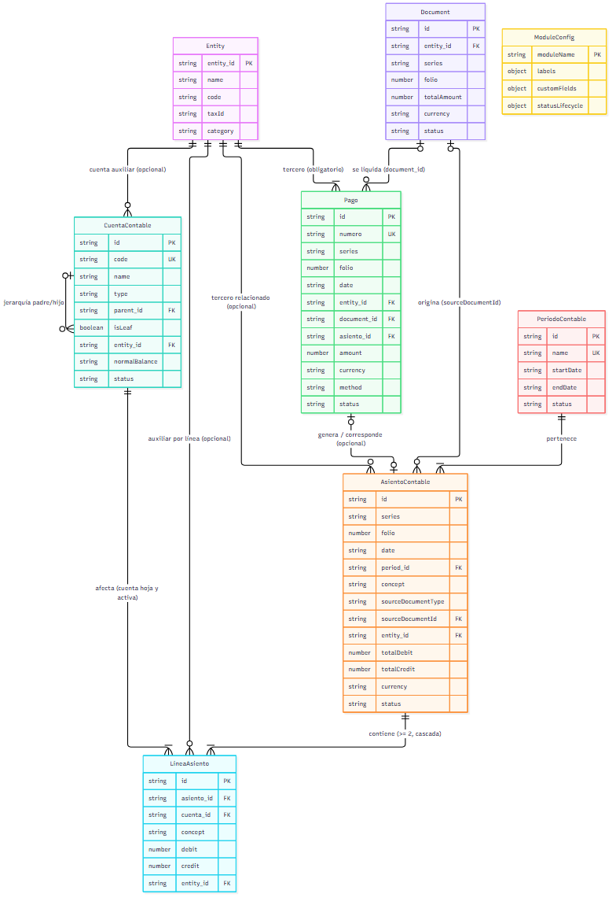
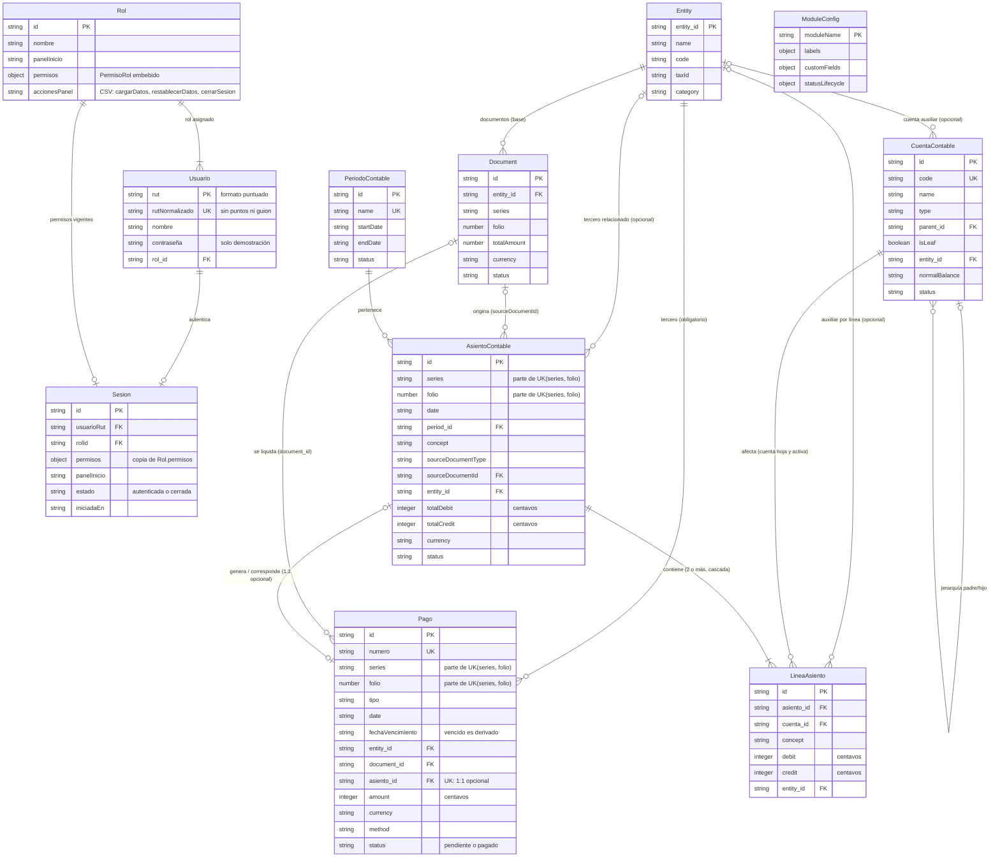

# Diagrama Entidad-Relación: Módulo de Contabilidad y Finanzas

Acompaña a [data-model.md](data-model.md). Las entidades base (`Entity`, `Document`, `ModuleConfig`) se muestran con sus campos clave; la definición completa está en [001-erp-base-module/data-model.md](../001-erp-base-module/data-model.md).

> Se conserva la representación de `Entity` (`entity_id` como PK) y de `ModuleConfig` (`moduleName` como PK), sin modificar sus claves. Las FK hacia `Entity` apuntan a `entity_id`; las FK hacia `Document` apuntan a `Document.id`.

> `Usuario`, `Rol` y `Sesion` incorporan el acceso simulado de las Historias de Usuario 8 y 9. `PermisoRol` se embebe en `Rol.permisos` y se copia a `Sesion.permisos`.

## Diagrama

[Ver diagrama en formato Mermaid (.mmd)](diagrama.mmd)

> `ModuleConfig` no participa en relaciones referenciales: se carga una sola vez al arrancar y aplica etiquetas, campos personalizados y ciclos de vida a las entidades del módulo.

> Los importes monetarios de las entidades nuevas se representan como enteros en centavos. `Document.totalAmount` es un campo base y no se modifica.

> La unicidad compuesta `(series, folio)` se documenta en los atributos porque Mermaid no expresa claves únicas compuestas de forma nativa. `Pago.asiento_id` es FK y UK (1:1 opcional).

> `vencido` no aparece como valor persistido de `Pago.status`: se deriva al comparar `fechaVencimiento` con la fecha actual para un pago pendiente.

## Leyenda de Cardinalidades

| Símbolo | Significado |
|---|---|
| `\|\|` | Exactamente uno (lado obligatorio) |
| `\|o` | Cero o uno (lado opcional izquierdo) |
| `o\|` | Cero o uno (lado opcional derecho) |
| `\|{` | Uno o más (mínimo 1) |
| `o{` | Cero o más (opcional, sin límite) |

## Relaciones

La cardinalidad se lee como **A ↔ B**: cuántos A puede tener cada B y cuántos B puede tener cada A. Esta tabla coincide fila a fila con la de [data-model.md](data-model.md#relaciones-y-cardinalidades).

| Relación | Cardinalidad | FK | Eliminación | Lectura |
|---|---|---|---|---|
| Rol ← Usuario | 1 a 1..* | `Usuario.rol_id` | `RESTRICT` | Todo usuario tiene un rol; cada rol tiene al menos un usuario de prueba |
| Usuario ← Sesion | 1 a 0..1 | `Sesion.usuarioRut` | `RESTRICT` | Una sesión autenticada como máximo por usuario |
| Rol ← Sesion | 1 a 0..1 | `Sesion.rolId` | `RESTRICT` | La sesión conserva una copia del rol vigente |
| Entity ← Document | 1 a 0..* | `Document.entity_id` | `CASCADE` (base) | Un documento pertenece a una entidad; una entidad tiene cero o más documentos |
| Entity ← CuentaContable | 0..1 a 0..* | `CuentaContable.entity_id` | `SET NULL` | Una cuenta puede tener un tercero auxiliar; un tercero puede tener cero o más cuentas |
| Entity ← AsientoContable | 0..1 a 0..* | `AsientoContable.entity_id` | `SET NULL` | Un asiento puede referenciar un tercero; un tercero puede tener cero o más asientos |
| Entity ← LineaAsiento | 0..1 a 0..* | `LineaAsiento.entity_id` | `SET NULL` | Una línea puede tener un tercero auxiliar; un tercero puede tener cero o más líneas |
| Entity ← Pago | 1 a 0..* | `Pago.entity_id` | `RESTRICT` | Todo pago involucra exactamente un tercero; un tercero puede tener cero o más pagos |
| Document ← AsientoContable | 0..1 a 0..* | `AsientoContable.sourceDocumentId` | `RESTRICT` | Un asiento proviene como mucho de un documento; un documento puede originar cero o más asientos |
| Document ← Pago | 0..1 a 0..* | `Pago.document_id` | `SET NULL` | Un pago liquida como mucho un documento; un documento puede liquidarse en cero o más pagos |
| PeriodoContable ← AsientoContable | 1 a 0..* | `AsientoContable.period_id` | `RESTRICT` | Todo asiento pertenece a exactamente un periodo; un periodo puede tener cero o más asientos |
| CuentaContable ← CuentaContable | 0..1 a 0..* | `CuentaContable.parent_id` | `RESTRICT` | Una cuenta tiene como mucho una cuenta padre; una cuenta padre puede tener cero o más hijas |
| CuentaContable ← LineaAsiento | 1 a 0..* | `LineaAsiento.cuenta_id` | `RESTRICT` | Toda línea afecta exactamente una cuenta; una cuenta puede tener cero o más líneas |
| AsientoContable ← LineaAsiento | 1 a 2..* | `LineaAsiento.asiento_id` | `CASCADE` | Toda línea pertenece a exactamente un asiento; todo asiento tiene dos o más líneas |
| AsientoContable ← Pago | 0..1 a 0..1 | `Pago.asiento_id` | `SET NULL` | Un pago genera o referencia como mucho un asiento; un asiento corresponde como mucho a un pago |

> Mermaid solo puede expresar el mínimo `1..*` para `AsientoContable ← LineaAsiento`; el mínimo de dos líneas se valida en la aplicación y queda documentado en la tabla.

## Reglas de Integridad Derivadas

- **Partida doble exacta**: por cada `AsientoContable`, `SUM(LineaAsiento.debit) = SUM(LineaAsiento.credit)` y `totalDebit = totalCredit`, con igualdad exacta de enteros en centavos y tolerancia `0`. Los totales se recalculan desde las líneas.
- **Acceso simulado**: `Sesion` copia `Rol.permisos` y `Rol.panelInicio` al autenticarse. Un cambio de rol requiere cerrar sesión; al cerrarla se elimina `Sesion`.
- **Cascadas**: la única cascada contable nueva es `AsientoContable → LineaAsiento` y solo aplica al borrado físico de asientos en `borrador`. `Document.entity_id → Entity.entity_id` es una cascada heredada del módulo base y no se modifica.
- **Historial contable**: `Entity` y `Document` no borran asientos, líneas, cuentas ni pagos. Las referencias opcionales usan `SET NULL`, salvo `AsientoContable.sourceDocumentId` que usa `RESTRICT`, y las obligatorias usan `RESTRICT` para no perder registros históricos.
- **Anulación lógica**: asientos cancelados y pagos pagados/vencidos conservan su registro. Los pagos no almacenan `vencido`: se deriva de `fechaVencimiento`.
- **Unicidad**: `code` en `CuentaContable`, `name` en `PeriodoContable`, `numero` en `Pago`, `rut`/`rutNormalizado` en `Usuario` e `id` en `Rol` son únicos. En `AsientoContable` y `Pago` la unicidad de `folio` es compuesta: `UNIQUE(series, folio)`, normalizando `series` vacía a cadena vacía. `Pago.asiento_id` es único.
- **Periodos**: un `AsientoContable` solo puede existir en un `PeriodoContable` con `status = abierto`; un periodo con asientos se cierra, no se elimina. Los periodos no pueden solaparse, sin importar su estado.
- **Semilla y restablecimiento**: cargar datos reemplaza colecciones financieras sin duplicar identificadores; restablecer las vacía conservando `Usuario` y `Rol`.

## Vistas Derivadas (no persistentes)

| Vista | Origen | Uso |
|---|---|---|
| `PermisoRol`, `OpcionMenu`, `PanelInicio` | `Rol` y `Sesion` | Menú filtrado y panel por rol (HU8, HU9) |
| `DatosEjemplo`, `EstadoInicial` | Fábricas puras de semilla | Botones del panel del Administrador (HU10) |
| `DestinoNavegacion`, `ControlAccion` | Mapa estático de navegación | Un único control por pantalla (HU11) |
| `EstadoPago`, `ResumenPagos` | `Pago.status` y `fechaVencimiento` | Resumen y filtro dentro de Pagos y cobros (HU12) |
| `SerieIngresosGastos`, `SerieResultado`, `DistribucionGastos` | Reportes y saldos | Gráficas del panel (HU7) |

## Alcance MVP

No se elimina ninguna de las cinco entidades contables originales; se añaden `Usuario`, `Rol` y `Sesion` para el acceso simulado.

| Entidad | Alcance | Motivo |
|---|---|---|
| Usuario | MVP | HU8: credenciales ficticias y panel por rol |
| Rol | MVP | HU8 y HU9: permisos y panel de inicio |
| Sesion | MVP | HU8: autenticación local y cierre de sesión |
| CuentaContable | MVP | Plan de cuentas necesario para clasificar los movimientos |
| AsientoContable | MVP | Cabecera del registro contable |
| LineaAsiento | MVP | Implementa la partida doble |
| PeriodoContable | MVP | `period_id` es obligatorio y controla periodos abiertos/cerrados |
| Pago | MVP | Tesorería/cobros/desembolsos y resumen por estado (HU4 y HU12) |

> Decisión confirmada: `Pago` forma parte del MVP (clarificación 2026-11-02).

## Decisiones Resueltas

1. **`AsientoContable.sourceDocumentId`: `RESTRICT`.** Conserva la trazabilidad del asiento a su documento de origen (clarificación 2026-11-02).
2. **`Pago` forma parte del MVP.** La Historia 4 y FR-013 a FR-016 lo exigen (clarificación 2026-11-02).
3. **Moneda única `MXN` sin conversión** (clarificación 2026-11-02).
4. **Sin solapamiento de periodos**, abiertos o cerrados (clarificación 2026-11-02).
5. **Autenticación simulada con `Usuario`, `Rol` y `Sesion` en `sessionStorage`** (HU8).
6. **Permisos derivados del rol copiados en la sesión; opciones no permitidas ocultas** (HU9).
7. **Semilla determinista reemplazable y restablecimiento que conserva usuarios** (HU10).
8. **Navegación única sin Entidades, Documentos ni Búsqueda** (HU11).
9. **`vencido` derivado de `fechaVencimiento`, no persistido** (HU12).
