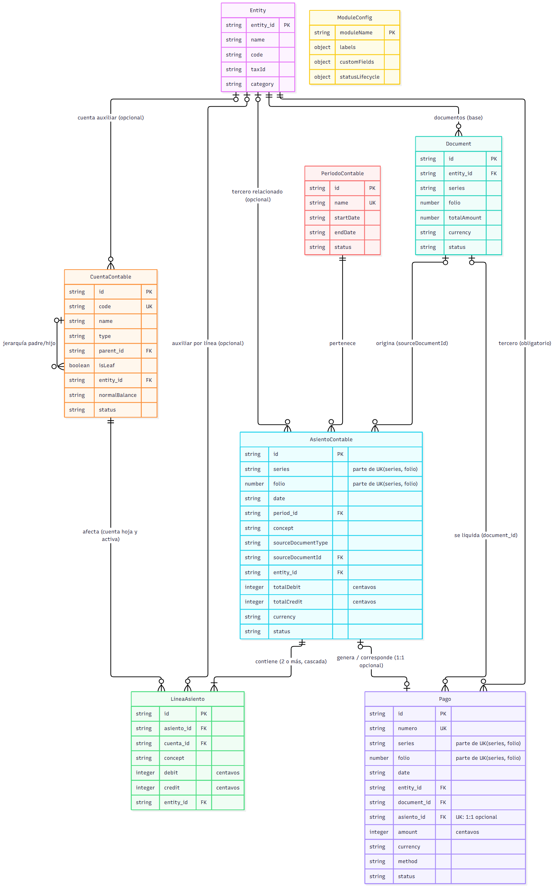
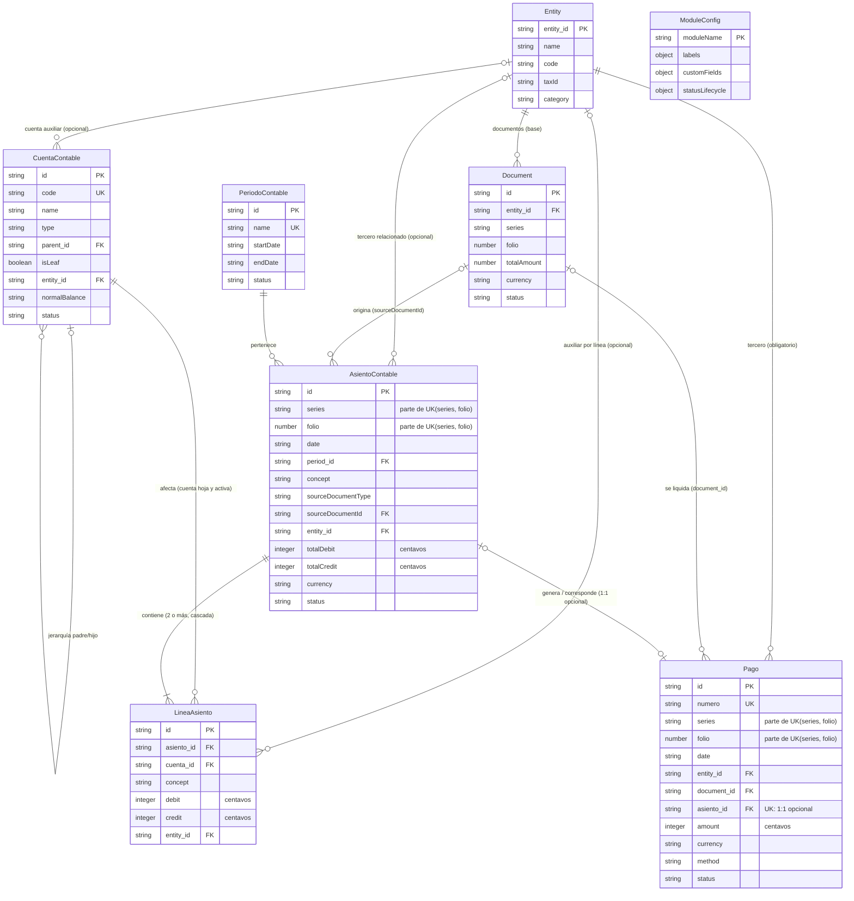

# Diagrama Entidad-Relación: Módulo de Contabilidad y Finanzas

Acompaña a [data-model.md](data-model.md). Las entidades base (`Entity`, `Document`, `ModuleConfig`) se muestran con sus campos clave; la definición completa está en [001-erp-base-module/data-model.md](../001-erp-base-module/data-model.md).

> Se conserva la representación de `Entity` (`entity_id` como PK) y de `ModuleConfig` (`moduleName` como PK), sin modificar sus claves. Las FK hacia `Entity` apuntan a `entity_id`; las FK hacia `Document` apuntan a `Document.id`.

## Diagrama

[Ver diagrama en formato Mermaid (.mmd)](diagrama.mmd)
`ModuleConfig` no participa en relaciones referenciales: se carga una sola vez al arrancar y aplica etiquetas, campos personalizados y ciclos de vida a las entidades del módulo.

> Los importes monetarios de las entidades nuevas se representan como enteros en centavos. `Document.totalAmount` es un campo base y no se modifica.

> La unicidad compuesta `(series, folio)` se documenta en los atributos porque Mermaid no expresa claves únicas compuestas de forma nativa. `Pago.asiento_id` es FK y UK (1:1 opcional).

## Leyenda de Cardinalidades

| Símbolo | Significado |
|---|---|
| `\|\|` | Exactamente uno (lado obligatorio) |
| `\|o` | Cero o uno (lado opcional izquierdo) |
| `o\|` | Cero o uno (lado opcional derecho) |
| `\|{` | Uno o más (mínimo 1) |
| `o{` | Cero o más (opcional, sin límite) |

## Relaciones

La cardinalidad se lee como **A ↔ B**: cuántos A puede tener cada B y cuántos B puede tener cada A. Esta tabla coincide fila a fila con la de [data-model.md](data-model.md#relaciones-y-cardinalidades).

| Relación | Cardinalidad | FK | Eliminación | Lectura |
|---|---|---|---|---|
| Entity ← Document | 1 a 0..* | `Document.entity_id` | `CASCADE` (base) | Un documento pertenece a una entidad; una entidad tiene cero o más documentos |
| Entity ← CuentaContable | 0..1 a 0..* | `CuentaContable.entity_id` | `SET NULL` | Una cuenta puede tener un tercero auxiliar; un tercero puede tener cero o más cuentas |
| Entity ← AsientoContable | 0..1 a 0..* | `AsientoContable.entity_id` | `SET NULL` | Un asiento puede referenciar un tercero; un tercero puede tener cero o más asientos |
| Entity ← LineaAsiento | 0..1 a 0..* | `LineaAsiento.entity_id` | `SET NULL` | Una línea puede tener un tercero auxiliar; un tercero puede tener cero o más líneas |
| Entity ← Pago | 1 a 0..* | `Pago.entity_id` | `RESTRICT` | Todo pago involucra exactamente un tercero; un tercero puede tener cero o más pagos |
| Document ← AsientoContable | 0..1 a 0..* | `AsientoContable.sourceDocumentId` | `SET NULL` (propuesto) o `RESTRICT` (pendiente) | Un asiento proviene como mucho de un documento; un documento puede originar cero o más asientos |
| Document ← Pago | 0..1 a 0..* | `Pago.document_id` | `SET NULL` | Un pago liquida como mucho un documento; un documento puede liquidarse en cero o más pagos |
| PeriodoContable ← AsientoContable | 1 a 0..* | `AsientoContable.period_id` | `RESTRICT` | Todo asiento pertenece a exactamente un periodo; un periodo puede tener cero o más asientos |
| CuentaContable ← CuentaContable | 0..1 a 0..* | `CuentaContable.parent_id` | `RESTRICT` | Una cuenta tiene como mucho una cuenta padre; una cuenta padre puede tener cero o más hijas |
| CuentaContable ← LineaAsiento | 1 a 0..* | `LineaAsiento.cuenta_id` | `RESTRICT` | Toda línea afecta exactamente una cuenta; una cuenta puede tener cero o más líneas |
| AsientoContable ← LineaAsiento | 1 a 2..* | `LineaAsiento.asiento_id` | `CASCADE` | Toda línea pertenece a exactamente un asiento; todo asiento tiene dos o más líneas |
| AsientoContable ← Pago | 0..1 a 0..1 | `Pago.asiento_id` | `SET NULL` | Un pago genera o referencia como mucho un asiento; un asiento corresponde como mucho a un pago |

> Mermaid solo puede expresar el mínimo `1..*` para `AsientoContable ← LineaAsiento`; el mínimo de dos líneas se valida en la aplicación y queda documentado en la tabla.

## Reglas de Integridad Derivadas

- **Partida doble exacta**: por cada `AsientoContable`, `SUM(LineaAsiento.debit) = SUM(LineaAsiento.credit)` y `totalDebit = totalCredit`, con igualdad exacta de enteros en centavos y tolerancia `0`. Los totales se recalculan desde las líneas.
- **Cascadas**: la única cascada contable nueva es `AsientoContable → LineaAsiento` y solo aplica al borrado físico de asientos en `borrador`. `Document.entity_id → Entity.entity_id` es una cascada heredada del módulo base y no se modifica.
- **Historial contable**: `Entity` y `Document` no borran asientos, líneas, cuentas ni pagos. Las referencias opcionales usan `SET NULL` y las obligatorias usan `RESTRICT` para no perder registros históricos.
- **Anulación lógica**: asientos y pagos aprobados, aplicados o cancelados no se borran físicamente; se anulan con `status = cancelado`. Cuentas con movimientos o hijas se inactivan; periodos con asientos se cierran.
- **Unicidad**: `code` en `CuentaContable`, `name` en `PeriodoContable` y `numero` en `Pago` son únicos. En `AsientoContable` y `Pago` la unicidad de `folio` es compuesta: `UNIQUE(series, folio)`, normalizando `series` vacía a cadena vacía. `Pago.asiento_id` es único.
- **Periodos**: un `AsientoContable` solo puede existir en un `PeriodoContable` con `status = abierto`; un periodo con asientos se cierra, no se elimina.

## Alcance MVP

No se elimina ninguna de las cinco entidades; solo se prioriza su implementación.

| Entidad | Alcance | Motivo |
|---|---|---|
| CuentaContable | MVP | Plan de cuentas necesario para clasificar los movimientos |
| AsientoContable | MVP | Cabecera del registro contable |
| LineaAsiento | MVP | Implementa la partida doble |
| PeriodoContable | MVP | `period_id` es obligatorio y controla periodos abiertos/cerrados |
| Pago | Fase futura | Tesorería/cobros/desembolsos; los asientos pueden registrarse sin él. Se conserva en el modelo |

> Si el MVP exige registrar cobros o desembolsos, `Pago` pasa a ser imprescindible. Esa decisión debe confirmarla el grupo.

## Decisiones Pendientes de Validación

1. **`AsientoContable.sourceDocumentId`: `SET NULL` vs `RESTRICT`.** `SET NULL` conserva el asiento histórico pero pierde la trazabilidad al documento; `RESTRICT` conserva el vínculo pero impide borrar un `Document` con asientos y, dado que `Document.entity_id` es `CASCADE` por regla base, también puede impedir borrar una `Entity` con documentos conciliados.
2. **¿El MVP incluye `Pago`?** Se propone dejarlo como fase futura; si el alcance exige cobros/desembolsos, debe pasar a MVP y validarse su ciclo de vida.

> `ModuleConfig` no participa en relaciones referenciales: se carga una sola vez al arrancar y aplica etiquetas, campos personalizados y ciclos de vida a las entidades del módulo.

> Los importes monetarios de las entidades nuevas se representan como enteros en centavos. `Document.totalAmount` es un campo base y no se modifica.

> La unicidad compuesta `(series, folio)` se documenta en los atributos porque Mermaid no expresa claves únicas compuestas de forma nativa. `Pago.asiento_id` es FK y UK (1:1 opcional).

## Leyenda de Cardinalidades

| Símbolo | Significado |
|---|---|
| `\|\|` | Exactamente uno (lado obligatorio) |
| `\|o` | Cero o uno (lado opcional izquierdo) |
| `o\|` | Cero o uno (lado opcional derecho) |
| `\|{` | Uno o más (mínimo 1) |
| `o{` | Cero o más (opcional, sin límite) |

## Relaciones

La cardinalidad se lee como **A ↔ B**: cuántos A puede tener cada B y cuántos B puede tener cada A. Esta tabla coincide fila a fila con la de [data-model.md](data-model.md#relaciones-y-cardinalidades).

| Relación | Cardinalidad | FK | Eliminación | Lectura |
|---|---|---|---|---|
| Entity ← Document | 1 a 0..* | `Document.entity_id` | `CASCADE` (base) | Un documento pertenece a una entidad; una entidad tiene cero o más documentos |
| Entity ← CuentaContable | 0..1 a 0..* | `CuentaContable.entity_id` | `SET NULL` | Una cuenta puede tener un tercero auxiliar; un tercero puede tener cero o más cuentas |
| Entity ← AsientoContable | 0..1 a 0..* | `AsientoContable.entity_id` | `SET NULL` | Un asiento puede referenciar un tercero; un tercero puede tener cero o más asientos |
| Entity ← LineaAsiento | 0..1 a 0..* | `LineaAsiento.entity_id` | `SET NULL` | Una línea puede tener un tercero auxiliar; un tercero puede tener cero o más líneas |
| Entity ← Pago | 1 a 0..* | `Pago.entity_id` | `RESTRICT` | Todo pago involucra exactamente un tercero; un tercero puede tener cero o más pagos |
| Document ← AsientoContable | 0..1 a 0..* | `AsientoContable.sourceDocumentId` | `SET NULL` (propuesto) o `RESTRICT` (pendiente) | Un asiento proviene como mucho de un documento; un documento puede originar cero o más asientos |
| Document ← Pago | 0..1 a 0..* | `Pago.document_id` | `SET NULL` | Un pago liquida como mucho un documento; un documento puede liquidarse en cero o más pagos |
| PeriodoContable ← AsientoContable | 1 a 0..* | `AsientoContable.period_id` | `RESTRICT` | Todo asiento pertenece a exactamente un periodo; un periodo puede tener cero o más asientos |
| CuentaContable ← CuentaContable | 0..1 a 0..* | `CuentaContable.parent_id` | `RESTRICT` | Una cuenta tiene como mucho una cuenta padre; una cuenta padre puede tener cero o más hijas |
| CuentaContable ← LineaAsiento | 1 a 0..* | `LineaAsiento.cuenta_id` | `RESTRICT` | Toda línea afecta exactamente una cuenta; una cuenta puede tener cero o más líneas |
| AsientoContable ← LineaAsiento | 1 a 2..* | `LineaAsiento.asiento_id` | `CASCADE` | Toda línea pertenece a exactamente un asiento; todo asiento tiene dos o más líneas |
| AsientoContable ← Pago | 0..1 a 0..1 | `Pago.asiento_id` | `SET NULL` | Un pago genera o referencia como mucho un asiento; un asiento corresponde como mucho a un pago |

> Mermaid solo puede expresar el mínimo `1..*` para `AsientoContable ← LineaAsiento`; el mínimo de dos líneas se valida en la aplicación y queda documentado en la tabla.

## Reglas de Integridad Derivadas

- **Partida doble exacta**: por cada `AsientoContable`, `SUM(LineaAsiento.debit) = SUM(LineaAsiento.credit)` y `totalDebit = totalCredit`, con igualdad exacta de enteros en centavos y tolerancia `0`. Los totales se recalculan desde las líneas.
- **Cascadas**: la única cascada contable nueva es `AsientoContable → LineaAsiento` y solo aplica al borrado físico de asientos en `borrador`. `Document.entity_id → Entity.entity_id` es una cascada heredada del módulo base y no se modifica.
- **Historial contable**: `Entity` y `Document` no borran asientos, líneas, cuentas ni pagos. Las referencias opcionales usan `SET NULL` y las obligatorias usan `RESTRICT` para no perder registros históricos.
- **Anulación lógica**: asientos y pagos aprobados, aplicados o cancelados no se borran físicamente; se anulan con `status = cancelado`. Cuentas con movimientos o hijas se inactivan; periodos con asientos se cierran.
- **Unicidad**: `code` en `CuentaContable`, `name` en `PeriodoContable` y `numero` en `Pago` son únicos. En `AsientoContable` y `Pago` la unicidad de `folio` es compuesta: `UNIQUE(series, folio)`, normalizando `series` vacía a cadena vacía. `Pago.asiento_id` es único.
- **Periodos**: un `AsientoContable` solo puede existir en un `PeriodoContable` con `status = abierto`; un periodo con asientos se cierra, no se elimina.

## Alcance MVP

No se elimina ninguna de las cinco entidades; solo se prioriza su implementación.

| Entidad | Alcance | Motivo |
|---|---|---|
| CuentaContable | MVP | Plan de cuentas necesario para clasificar los movimientos |
| AsientoContable | MVP | Cabecera del registro contable |
| LineaAsiento | MVP | Implementa la partida doble |
| PeriodoContable | MVP | `period_id` es obligatorio y controla periodos abiertos/cerrados |
| Pago | Fase futura | Tesorería/cobros/desembolsos; los asientos pueden registrarse sin él. Se conserva en el modelo |

> Si el MVP exige registrar cobros o desembolsos, `Pago` pasa a ser imprescindible. Esa decisión debe confirmarla el grupo.

## Decisiones Pendientes de Validación

1. **`AsientoContable.sourceDocumentId`: `SET NULL` vs `RESTRICT`.** `SET NULL` conserva el asiento histórico pero pierde la trazabilidad al documento; `RESTRICT` conserva el vínculo pero impide borrar un `Document` con asientos y, dado que `Document.entity_id` es `CASCADE` por regla base, también puede impedir borrar una `Entity` con documentos conciliados.
2. **¿El MVP incluye `Pago`?** Se propone dejarlo como fase futura; si el alcance exige cobros/desembolsos, debe pasar a MVP y validarse su ciclo de vida.
