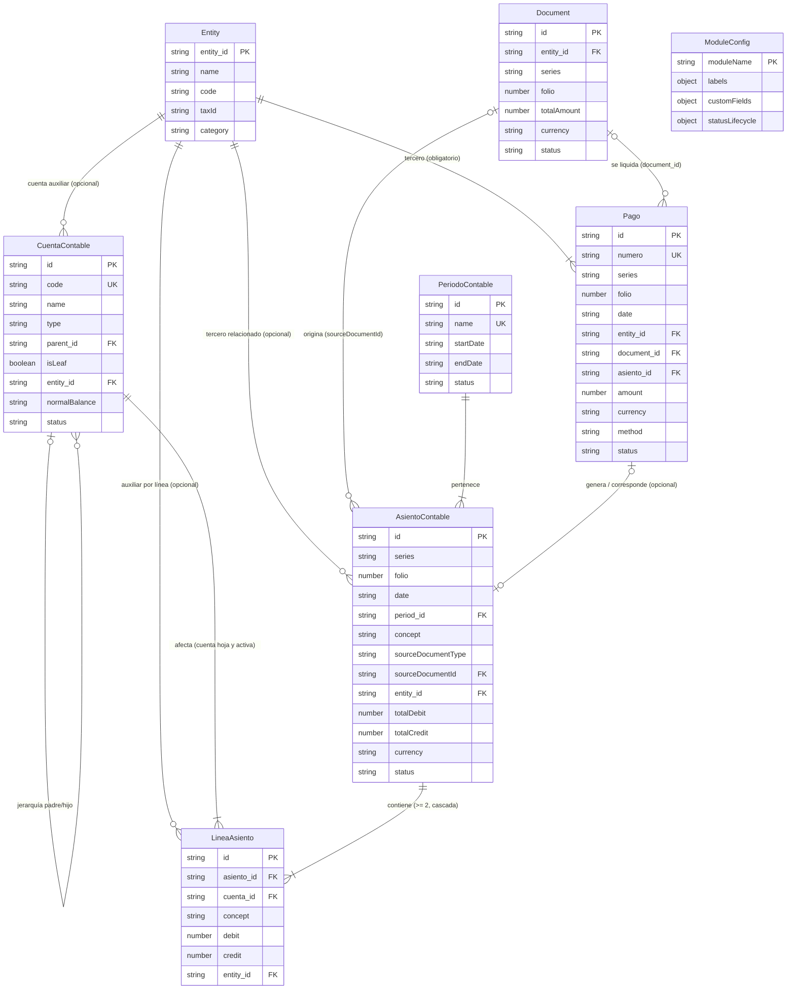

# Diagrama Entidad-Relación: Módulo de Contabilidad y Finanzas

Acompaña a [data-model.md](data-model.md). Las entidades base (`Entity`, `Document`, `ModuleConfig`) se muestran con sus campos clave; la definición completa está en [001-erp-base-module/data-model.md](../001-erp-base-module/data-model.md).

## Diagrama

[Ver diagrama en formato Mermaid (.mmd)](diagrama.mmd)

> `ModuleConfig` no participa en relaciones referenciales: se carga una sola vez al arrancar y aplica etiquetas, campos personalizados y ciclos de vida a las entidades del módulo.

## Leyenda de Cardinalidades

| Símbolo | Significado |
|---|---|
| `\|\|` | Exactamente uno (lado obligatorio) |
| `\|o` | Cero o uno (lado opcional) |
| `\|{` | Uno o más (mínimo 1) |
| `o{` | Cero o más (opcional, sin límite) |

## Relaciones

| Relación | Lectura | FK |
|---|---|---|
| Entity 1 — 0..* CuentaContable | Un tercero puede tener cuentas auxiliares (opcional) | `CuentaContable.entity_id` |
| Entity 1 — 0..* AsientoContable | Un asiento puede involucrar un tercero (opcional) | `AsientoContable.entity_id` |
| Entity 1 — 0..* LineaAsiento | Auxiliar por línea para reportes por tercero (opcional) | `LineaAsiento.entity_id` |
| Entity 1 — * Pago | Todo pago involucra exactamente un tercero (obligatorio) | `Pago.entity_id` |
| Document 0..1 — 0..* AsientoContable | Un documento origina cero o varios asientos | `AsientoContable.sourceDocumentId` |
| Document 0..1 — 0..* Pago | Un documento se liquida en cero o varios pagos | `Pago.document_id` |
| PeriodoContable 1 — * AsientoContable | Todo asiento pertenece a un periodo contable | `AsientoContable.period_id` |
| CuentaContable 0..1 — 0..* CuentaContable | Jerarquía padre/hijo sin ciclos | `CuentaContable.parent_id` |
| CuentaContable 1 — * LineaAsiento | Toda línea afecta una cuenta hoja activa | `LineaAsiento.cuenta_id` |
| AsientoContable 1 — * LineaAsiento | Todo asiento tiene dos o más líneas (eliminación en cascada) | `LineaAsiento.asiento_id` |
| Pago 0..1 — 0..1 AsientoContable | Un pago puede generar/corresponder como mucho a un asiento (opcional) | `Pago.asiento_id` |

## Reglas de Integridad Derivadas

- **Partida doble**: por cada `AsientoContable`, `SUM(LineaAsiento.debit) = SUM(LineaAsiento.credit)`, persistido en `totalDebit = totalCredit`.
- **Cascadas**: eliminar un `AsientoContable` elimina sus `LineaAsiento`; eliminar una `Entity` elimina sus `Document` (regla base) y sus `Pago`.
- **Unicidad**: `code` único en `CuentaContable`; `folio` único por `series` en `AsientoContable` y `Pago` (convención serie+folio del módulo base); `name` único en `PeriodoContable`.
- **Periodos**: un `AsientoContable` solo puede existir en un `PeriodoContable` con `status = abierto`.
